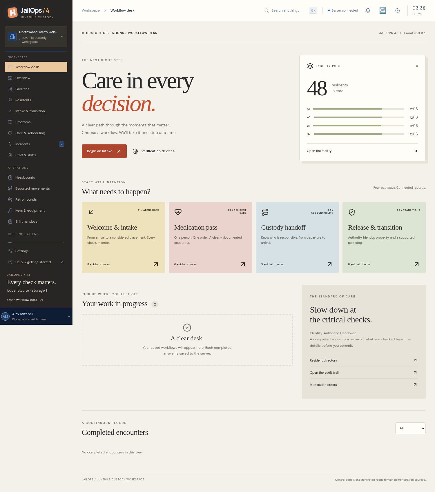
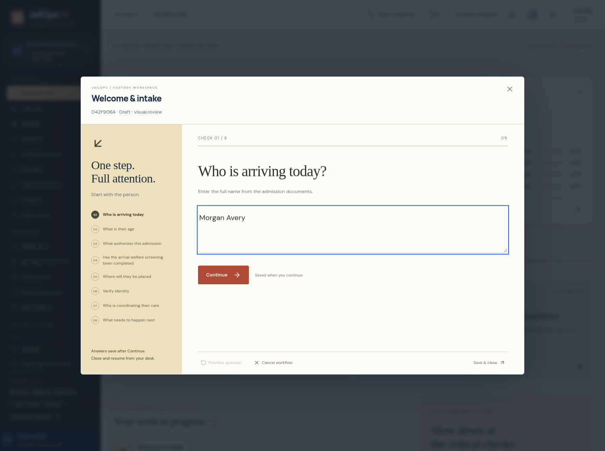
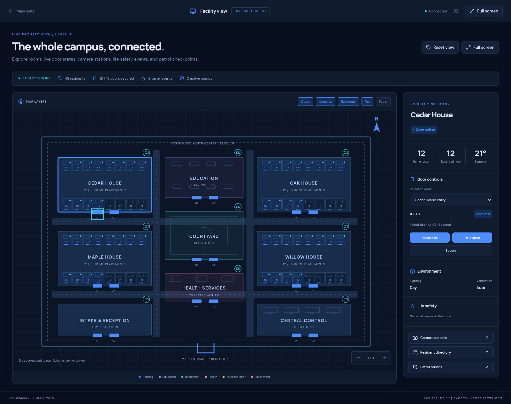

# JailOps — Windows x64 downloads

## Current: v4.1.1

[**Download JailOps v4.1.1 for Windows x64 (99.2 MB)**](https://github.com/Developer-CJ/JailOpsSim/raw/refs/heads/deployment-download/JailOps-Windows-x64-v4.1.1.zip)

A redesigned React + Node.js suite with local SQLite, a focused workflow desk, and guided intake, medication pass, custody handoff, and release interviews. Saved drafts, conditional holds, identity checks, review attestations, and closed encounter records connect with the existing resident and movement modules. The complete v2/v3 module baseline remains available.

- **U.are.U 4500:** preserves the WBF driver; includes a self-contained Windows x64 .NET 10 staff fingerprint bridge and its source. It verifies the enrolled Windows staff user; resident identity is separately attested. Physical Windows reader operation still needs workstation validation.
- **MSR213U-12AUBNR:** facility-card enrollment, keyed digests, revocation, and selected-resident matching when configured for keyboard output. Exact reader configuration needs physical verification.
- **Version notation:** `4.<build>.<storage>`; 0 = no database, 1 = SQLite, 9 = CJIT-SHARED. This release is build 1, SQLite storage 1.

[What’s new](WHATS_NEW_V4.md) · [Windows deployment](DEPLOY-WINDOWS.md) · [Device setup](DEVICE_INTEGRATION.md) · [Version sequence](VERSIONING.md)

Extract the complete ZIP and run **Install.cmd**, then **Start.cmd**. Application source, React assets, Node API, production dependencies, Windows Node runtime, and the optional WBF workstation executable are included. For an upgrade, back up first and retain `.env` and the entire `data` folder, including `reader-key`. The archive has no live accounts, private configuration, or database files.

**Verified:** 30 browser workflows, 15 backend integration tests, formatting, extracted package sign-in and SQLite persistence/backup checks, WBF bridge compilation and Windows x64 cross-publication, and bridge HTTP origin/binding/replay smoke checks. Native Windows Task Scheduler and physical USB verification were not executed. Building controls and generated feeds remain demonstration sources. The suite is an evaluation build, not a validated clinical/custodial deployment.

SHA-256: `d4f79a30cd24fff30b995c14ac5d5f4d6d90527aecbc3176a0eefbe3c8e0c450`

---

# Previous Windows releases

## Version 3.0.0

[**Download JailOpsSim v3.0.0 for Windows Server x64 (52.7 MB)**](https://github.com/Developer-CJ/JailOpsSim/raw/refs/heads/deployment-download/JailOpsSim-Windows-x64-v3.0.0.zip)

A complete suite with the original 14 modules preserved, plus 12 new features:

1. Detailed tactical facility view with 64 selectable rooms and live system layers.
2. Dedicated full-screen console windows and focused fire-panel operation.
3. Blue dark and light themes.
4. Resident identity headcounts and discrepancy records.
5. Escorted movement planning and arrival tracking.
6. Nine-zone patrol rounds with inspection notes.
7. Intercom station calls and history.
8. Zone-selectable public address dispatch.
9. Lighting scenes, temperature, and ventilation controls.
10. Key, radio, and equipment custody.
11. Shift handovers and assigned follow-ups.
12. Guided drills with verified actions and checklist scores.

[Feature guide and screenshots](WHATS_NEW_V3.md) · [Full application source](https://github.com/Developer-CJ/JailOpsSim/tree/main) · [Windows deployment instructions](DEPLOY-WINDOWS.md)

Extract the complete ZIP, run **Install.cmd** to create your own administrator account, then **Start.cmd**. The package includes the React assets, JavaScript/Express backend, SQLite engine, official Windows x64 Node runtime, production dependencies, all application source, and Windows deployment/backup scripts. No npm install is needed on the target server.

For an upgrade, back up your database, stop the application, and retain your `.env` and complete data directory when replacing application files. The v2 database migration preserves existing records, accounts, sessions, audit history, and settings.

**Validation:** 25 browser workflows and 10 backend tests pass. The extracted deployment package passed sign-in, dark mode, the detailed facility map, access controls, headcounts, SQLite persistence after restart, and consistent backup checks. Native Windows startup and Task Scheduler execution still require verification on the target server. No live accounts, environment secrets, or database files are bundled.

SHA-256: `a24a6561c4e39bfe9b7c5dc57391780ec7c770c2a1ab8e2c775f382cec302118`

## Preserved version 2 baseline

[Download the original Windows Server v2.0.0 package](https://github.com/Developer-CJ/JailOpsSim/raw/refs/heads/deployment-download/JailOpsSim-Windows-x64-v2.0.0.zip)

The original package remains available. Its complete source is preserved at [v2.0.0-baseline](https://github.com/Developer-CJ/JailOpsSim/tree/v2.0.0-baseline). Version 3 is tagged [v3.0.0](https://github.com/Developer-CJ/JailOpsSim/tree/v3.0.0). [Baseline preservation rules](BASELINE.md) apply to future work.
