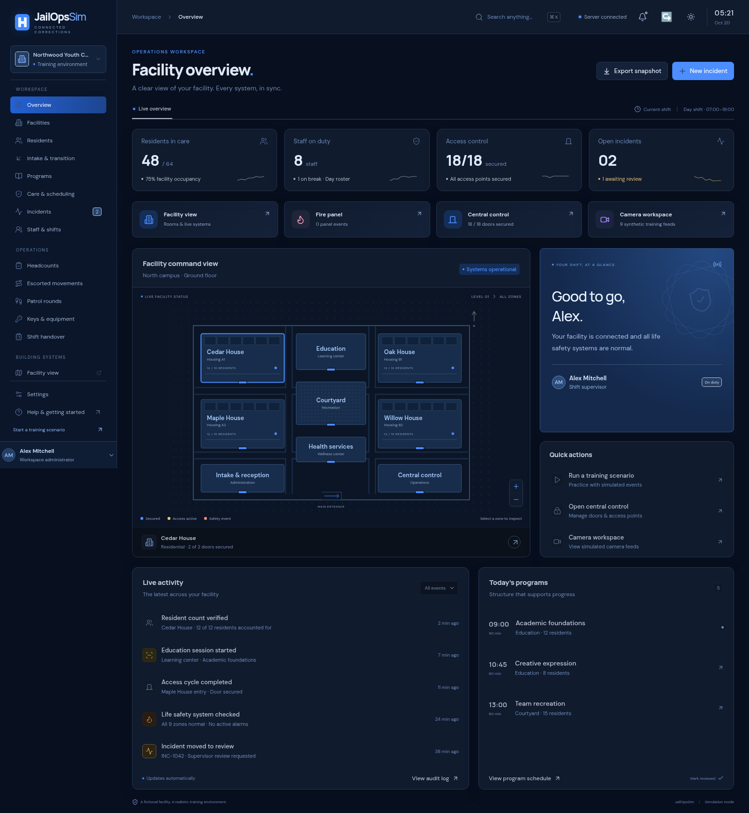
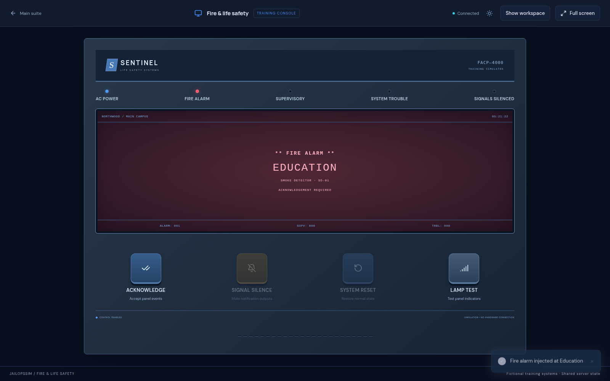

# JailOpsSim 3.0 — connected control suite

All 14 existing modules remain. Version 3 adds the following 12 features.

| Feature                    | Behavior                                                                                                                                                                                                                                                                                |
| -------------------------- | --------------------------------------------------------------------------------------------------------------------------------------------------------------------------------------------------------------------------------------------------------------------------------------- |
| Tactical facility view     | Detailed nine-zone floor plan, 64 selectable housing rooms, paired door devices, camera shortcuts, alarm and patrol overlays, layer controls, zoom/pan, live zone inspector, and room profiles. Door controls use the existing backend interlocks.                                      |
| Dedicated control windows  | Main-suite selections launch separate facility, access, fire, camera, communications, and environment windows. Each has a full-screen control. Fire includes a focused physical-panel view. A same-window link is available when popups are blocked.                                    |
| Blue dark and light themes | Dark navy surfaces, blue actions, cyan/violet/rose system accents, theme-aware existing modules, and a per-browser theme preference synchronized between windows.                                                                                                                       |
| Resident headcounts        | Capture a house roster, verify identities individually, record discrepancies, retain completed results, and export the original roster and result.                                                                                                                                      |
| Escorted movements         | Select a resident, destination, purpose, and on-duty escort. Progress from queued through en route to confirmed arrival. Arrival updates the facility’s recorded location while retaining the home placement. Discharge cancels outstanding movements and removes the current location. |
| Patrol rounds              | Assign an on-duty officer to a nine-zone round. Record time-stamped inspection notes at each checkpoint. Every checkpoint must be verified before completion.                                                                                                                           |
| Intercom console           | Simulate calls at nine stations, answer a waiting call, end it, and retain call history. One station may be connected at a time. The display represents a simulated audio path.                                                                                                         |
| Public address dispatch    | Select one or more campus zones, compose a routine or urgent announcement, and save its message, destinations, and dispatch time. No actual audio is broadcast.                                                                                                                         |
| Lighting and HVAC          | Set each zone’s day/evening/night lighting scene, 16–28°C temperature setpoint, and automatic/boost ventilation. The facility inspector reflects saved values.                                                                                                                          |
| Keys and equipment         | Check training key sets, portable radios, and equipment out to on-duty staff. Track current custody and return items to storage. Custody changes remain in the audit trail.                                                                                                             |
| Shift handovers            | Create follow-ups with priority, owner, and shift notes; mark them complete; preserve and export the handover record.                                                                                                                                                                   |
| Guided exercises           | Five-step fire response, access interlock, and resident accountability drills. Steps must be completed in sequence. The backend checks connected system state for relevant steps. Completed exercises save their timestamps and checklist score.                                        |

## Typical workflow

1. Sign in, then select **Facility view** from the dashboard console launchers.
2. Select a zone, room, camera station, or paired door on the detailed plan.
3. Return to the suite to start a count, movement, patrol, or handover.
4. Start a **Fire response** guided drill. It creates a simulated fire event in the selected zone.
5. Open the fire console and work through acknowledgement, silence, source restoration, and reset. Verify each corresponding checklist step before continuing.
6. Complete the exercise to save its verified checklist score.

Use **Focus panel** in the fire window to fill the workspace with the panel; use **Show workspace** to return to event injection, source restoration, and event history. Browser full-screen remains a separate user-controlled button.

The guided drill score measures completed simulator checkpoints, rather than professional proficiency. Camera scenes, intercom audio paths, PA dispatch, building environment, access controls, and life safety equipment are fictional training features.

## Upgrading from version 2

Back up the database, stop JailOpsSim, and replace application files with version 3 while retaining `.env` and the complete configured data directory. Run Install and restart. The first launch adds the new module data without replacing existing records, accounts, or preferences. Do not extract over a running installation.

The original Windows deployment, account creation, scheduled startup, backup, and restore instructions still apply. Native Windows/Task Scheduler execution must be checked on the destination server; the automated package checks run on Linux.

## Screenshots

The main suite, detailed facility console, and focused fire panel:

